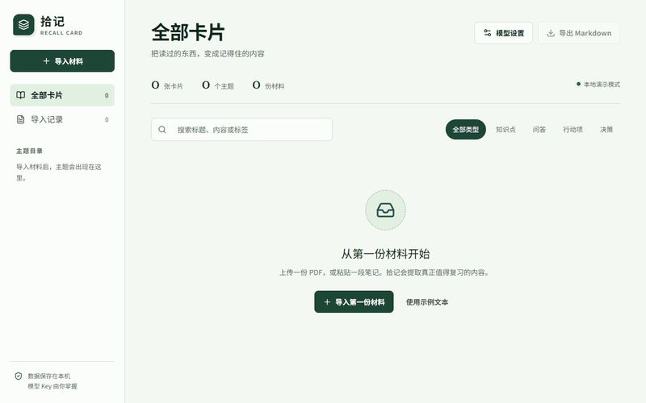

# Recall Card / 拾记

Turn PDFs, study notes and web pages into cards you can actually review. Runs locally with your own model key, SQLite storage, topic organization, editing and Markdown export.



[中文说明](./README.md)

## Windows: three steps, no setup required

1. Download `RecallCard.exe` from [Releases](https://github.com/Griffin-xcy/recall-card/releases/latest)
2. Double-click it. Your browser opens automatically; if it does not, visit `http://127.0.0.1:8765`
3. It already contains sample cards. Import your own notes, or explore the samples first

No Python, no Node, no Docker, no terminal. One 26 MB executable.

The first launch seeds a sample material, so you can see what the output looks like before you have an API key. The sample is seeded once; deleting it will not bring it back. To generate your own cards, click **Connect model**, pick DeepSeek and paste a key (DeepSeek is the cheapest option). The dialog links straight to each provider's key page.

> **The first double-click takes 10-20 seconds**, and the console window may look empty. It is unpacking the runtime, not hanging. The browser opens on its own once it is ready. Later launches are fast.
> **How do I quit?** Close the black console window.
> **Where is my data?** `%LOCALAPPDATA%\RecallCard`. Deleting that folder clears everything.
> **Antivirus warning?** A known trade-off of single-file executables. The source is fully public; use Docker if you would rather avoid it.

## Features

- Import PDF and text/code files with any extension, including TXT, Markdown, Python, JavaScript and JSON; import pasted text or public web pages
- Recursively select folders, track per-file progress, continue after failures, retry only failed files and preserve relative source paths
- Generate knowledge, Q&A, action and decision cards through any OpenAI-compatible API
- Customizable topics and card kinds managed in settings, with the prompt adapting accordingly
- Fixed topics, text chunking and JSON retry; skip files whose text matches a completed import and deduplicate questions or titles across materials, with a clear notice when an edit would create a duplicate
- Repeated files are shown with distinct "skipped / processing / completed / failed" states and support "skip / regenerate / overwrite" actions; failed files can be re-imported without being mistaken for duplicates
- Background async processing with progress polling, plus structured logging of processing and model call latency
- Search, filter, edit and delete cards
- Import history with visible failure reasons
- Export topic-organized Markdown files as ZIP
- Responsive UI, single-file Windows executable, Docker Compose, CI and automated tests

The first release intentionally excludes accounts, cloud sync, RAG chat, mobile apps, Anki and review scheduling.

## Run with Docker

Useful for servers, or if Docker is already part of your workflow.

```bash
docker compose up --build
```

Open http://localhost:8000 and click **Connect model**, then choose a provider and enter your API key. Presets cover DeepSeek, Kimi (Moonshot AI), OpenAI, Qwen, Zhipu AI and local Ollama, plus custom OpenAI-compatible endpoints. Base URLs and model names remain editable. For Qwen, replace `WorkspaceId` with your Alibaba Cloud workspace ID; for Ollama, start the local service and pull the selected model first. No `.env` editing is required. Settings and content are stored in the local SQLite database under `./data`; keys are never echoed back by the API or included in exports. You can still preset values through `.env.example`.

## Build the executable yourself

```powershell
pwsh -File scripts/build_exe.ps1
```

The result is `release\RecallCard.exe`. The script installs dependencies, builds the frontend, generates the icon and runs PyInstaller.

## Local development

Requires Python 3.12+ and Node.js 22+.

```bash
python -m venv .venv
# Windows: .venv\Scripts\python -m pip install -r requirements-dev.txt
# macOS / Linux: .venv/bin/python -m pip install -r requirements-dev.txt
npm install
npm run dev
```

Open http://localhost:7100 by default. The development command starts both Vite and FastAPI. CLI `--host` and `--port` arguments are forwarded to Vite; `PORT` in `.env` controls the backend port.

For a no-key workflow demo, set `LLM_PROVIDER=mock`. This uses deterministic local extraction, not AI, and is intended only for testing the product flow.

## Verification

```bash
python -m pytest -q
npm run lint
npm run build
```

After `npm run build`, FastAPI serves the built frontend and API from the same origin:

```bash
uvicorn backend.main:app --host 0.0.0.0 --port 8000
```

## Configuration

| Variable | Default | Purpose |
| --- | --- | --- |
| `BASE_URL` | `https://api.deepseek.com/v1` | OpenAI-compatible API base URL |
| `API_KEY` | empty | Your model provider key |
| `MODEL` | `deepseek-flash` | Model name |
| `LLM_PROVIDER` | `openai` | `openai` or `mock` |
| `PORT` | `8000` | Local backend port |
| `DATA_DIR` | `data` | SQLite data directory |
| `MAX_UPLOAD_MB` | `15` | Upload size limit |

Only text-based PDFs are supported; scanned documents need OCR first. Public HTML extraction may not work for login-protected or JavaScript-heavy pages. Processing is synchronous and designed for a single local user, not public multi-tenant deployment.

## License

MIT
