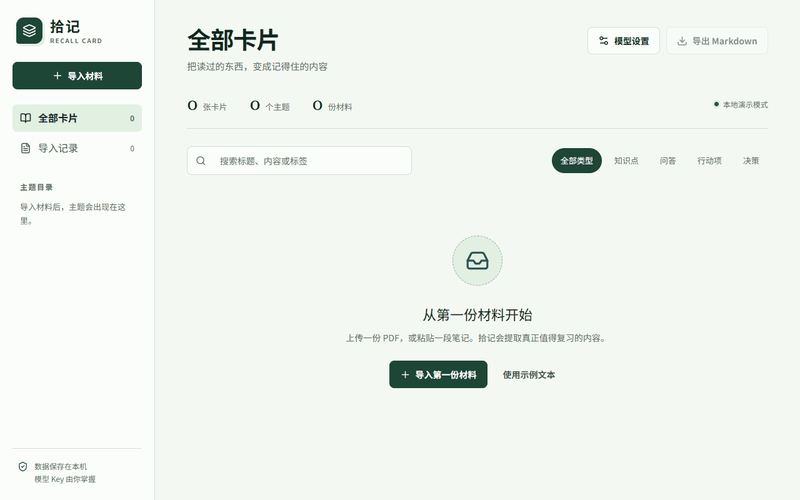
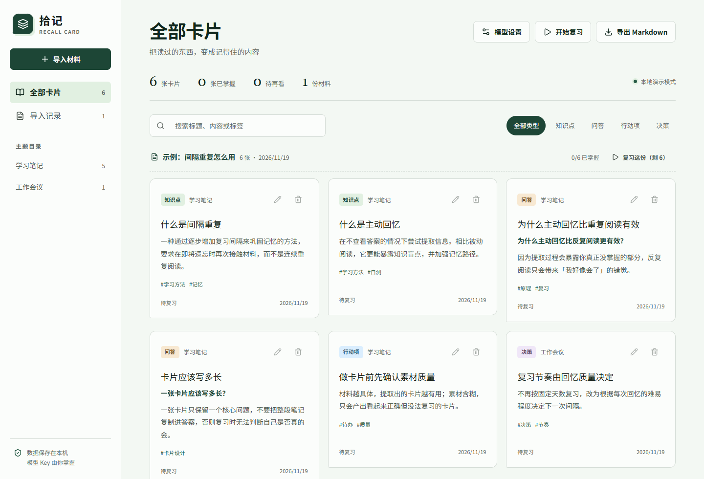
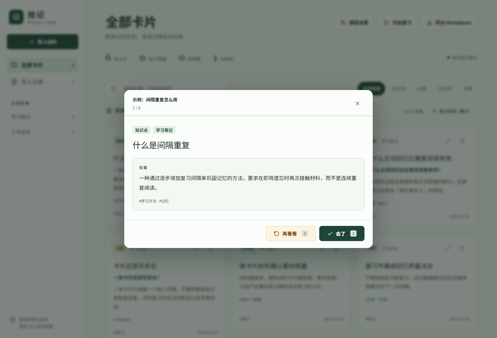

# 拾记 Recall Card

把 PDF、课程笔记和网页变成真正能复习的卡片。本地运行、自己的模型 Key、SQLite 存储，支持主题归档、编辑和 Markdown 导出。







[English README](./README.en.md)

## Windows 用户：三步开始（不用装任何环境）

1. 到 [Releases](https://github.com/Griffin-xcy/recall-card/releases/latest) 下载 `RecallCard.exe`
2. 双击它。浏览器会自动打开，没跳出来就手动访问 `http://127.0.0.1:8765`
3. 打开就有一份示例卡片。点「导入」上传自己的笔记，或先玩示例

不需要 Python、不需要 Node、不需要 Docker、不需要命令行。**单个 exe，26 MB，双击即用。**

第一次打开会自带一份示例材料，所以就算你没有 API Key，也能先看到成品长什么样。示例只写一次，删掉之后不会再冒出来。

想生成自己的卡片，点右上角「连接模型」，选 DeepSeek 填 Key 即可（DeepSeek 最便宜，充 10 块能用很久）。对话框里有「去开放平台申请」的直达链接，不知道去哪拿 Key 就点它。

> **第一次双击会慢一点**，大概 10 到 20 秒，黑窗口里可能是空的。它在解压运行环境，不是卡死，等一会儿浏览器会自己跳出来。第二次开就快了。
> **用完怎么退出？** 直接关掉那个黑色命令窗口。
> **数据存在哪？** `%LOCALAPPDATA%\RecallCard`，删掉这个文件夹等于清空所有数据。
> **杀毒软件报警？** 单文件 exe 是打包工具的通病，源码完全公开，介意的话用下面的 Docker 方式。

## 已实现

- 上传 PDF 以及 TXT、Markdown、PY、JS、JSON 等任意扩展名的文本和代码文件，递归选择整个文件夹并批量处理，或直接粘贴文本、提交网页链接
- 文件夹导入显示逐份进度；单份失败不中断队列，可只重试失败项，并保留相对来源路径
- 通过任意 OpenAI 兼容接口生成知识点、问答、行动项、决策四类卡片
- 主题与卡片类型可在设置中自定义增删，提示词随之动态调整
- 固定主题表、文本分块、JSON 解析重试；跳过内容相同的已完成文件，并对不同材料中的相同问题或标题去重，编辑产生重复时给出明确提示
- 重复文件在导入界面用「重复跳过 / 处理中 / 已完成 / 失败」四种状态区分，支持「跳过 / 重新生成 / 覆盖旧版本」三种处理；失败文件重新导入不会被误判为重复
- 材料后台异步处理，导入后轮询进度，不阻塞界面；结构化日志记录处理与模型调用耗时
- 卡片按来源材料分组，一眼看清每份文件生成了什么
- 复习模式：逐张翻面看答案，标记「会了 / 再看看」，结束时给出本轮统计
- 卡片搜索、类型与主题筛选、编辑、删除
- 导入记录与失败原因展示
- 按主题导出 Markdown ZIP
- 响应式网页、单文件 exe、Docker Compose、CI 与自动化测试

第一版有意不做：登录、多用户、云同步、RAG 问答、移动 App、Anki 和复习队列。

## Docker 启动

适合部署在服务器上，或者你本来就习惯用 Docker。

```bash
docker compose up --build
```

国内拉取 Docker Hub 基础镜像可能很慢，先在 Docker Desktop 的「设置 → Docker Engine」里配置镜像加速，否则这一步容易卡住。

打开 http://localhost:8000 ，点击右上角“连接模型”，先选择服务商，再输入 API Key。已内置 DeepSeek、Kimi（Moonshot AI）、OpenAI、通义千问、智谱 AI 和 Ollama（本地）预设，也可使用自定义 OpenAI 兼容接口；接口地址和模型名仍可修改。选择通义千问时需将地址中的 `WorkspaceId` 替换为实际业务空间 ID；使用 Ollama 前需先启动本地服务并下载对应模型。页面保存的设置与材料都存放在 `./data` 的 SQLite 数据库中，重建容器不会清空；API Key 不会回显到页面或包含在导出文件中。仍可通过 `.env` 预设配置，方法见 `.env.example`。

## 自己打包 exe

```powershell
pwsh -File scripts/build_exe.ps1
```

产物在 `release\RecallCard.exe`。脚本会依次安装依赖、构建前端、生成图标、调用 PyInstaller。

## 本地开发

要求 Python 3.12+ 与 Node.js 22+。

```bash
python -m venv .venv
# Windows: .venv\Scripts\python -m pip install -r requirements-dev.txt
# macOS / Linux: .venv/bin/python -m pip install -r requirements-dev.txt
npm install
npm run dev
```

打开终端显示的地址，默认是 http://localhost:7100 。`npm run dev` 会同时启动 Vite 和 FastAPI，并将 `/api` 代理到 `PORT` 指定的后端端口（默认 8000）。命令行的 `--host`、`--port` 参数会传给 Vite。

### 无密钥流程演示

在 `.env` 中设置 `LLM_PROVIDER=mock`，即可用确定性的本地提取器验证上传、编辑和导出流程。此模式不会调用 AI，也不代表真实模型的卡片质量；实际使用时改回 `LLM_PROVIDER=openai`。

## 常用命令

```bash
# 后端测试（先激活 .venv，或直接使用环境内的 Python）
python -m pytest -q

# 前端检查、生产构建与真实浏览器验收
npm run lint
npm run build
npm run test:e2e  # 使用本机 Edge；其他系统先运行 npx playwright install chromium
python scripts/smoke.py  # 冷启动生产服务，检查页面、脚本、图标和健康接口

# 生产模式：构建后由 FastAPI 同源提供页面和 API
.venv/bin/python -m uvicorn backend.main:app --host 0.0.0.0 --port 8000
# Windows 使用 .venv\Scripts\python
```

## 项目结构

```text
backend/
  main.py       FastAPI 接口与静态页面托管
  pipeline.py   分块、模型调用、去重、入库
  extractor.py  PDF / 文本 / 网页正文提取
  llm.py        OpenAI 兼容调用与 JSON 兜底
  db.py         SQLite 数据访问
  export.py     按主题生成 Markdown ZIP
src/
  pages/        工作台
  components/   导入、编辑、确认弹窗
  api.ts        前端 API 客户端
samples/        可直接导入的示例材料
tests/          接口与核心逻辑测试
```

## 模型配置

| 变量 | 默认值 | 说明 |
| --- | --- | --- |
| `BASE_URL` | `https://api.deepseek.com/v1` | OpenAI 兼容接口地址 |
| `API_KEY` | 空 | 模型服务密钥，不要提交到 Git |
| `MODEL` | `deepseek-flash` | 模型名称 |
| `LLM_PROVIDER` | `openai` | `openai` 或 `mock` |
| `PORT` | `8000` | 本地后端端口 |
| `DATA_DIR` | `data` | 数据库目录 |
| `MAX_UPLOAD_MB` | `15` | 单文件大小上限 |

网页提取只支持公开可访问的 HTML 页面；需要登录或强依赖 JavaScript 的页面可能无法提取。PDF 仅支持可复制文本，扫描件需先 OCR。当前处理请求为同步执行，适合个人本地使用，不适合作为多租户服务直接暴露到公网。

## License

MIT
